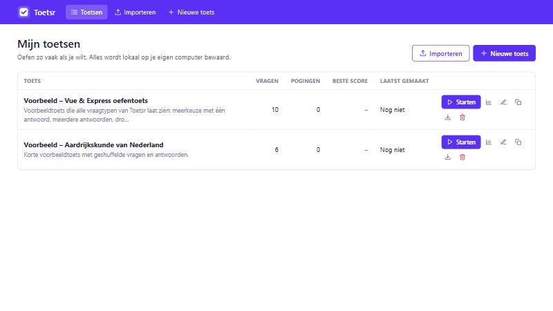
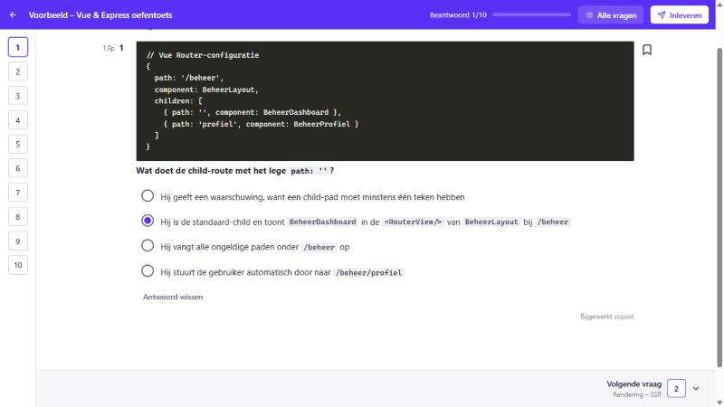
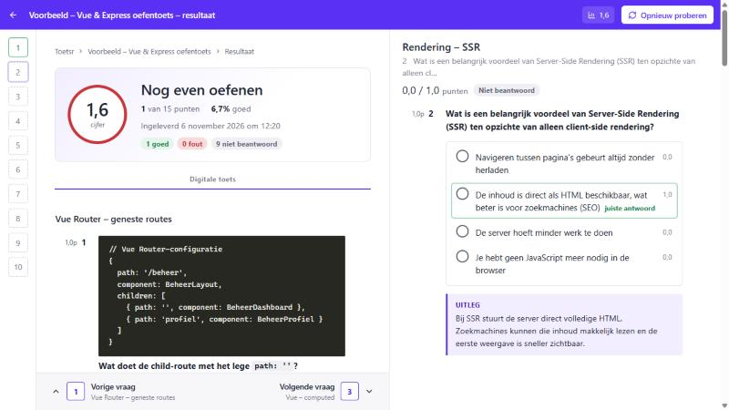

# Dino

**Dino** is een open-source app om oefentoetsen te maken en te oefenen, helemaal lokaal op je eigen computer.
Maak zelf vragen, of laat ChatGPT of Claude een toets genereren en plak die erin. Maak de toets zo vaak als je wilt;
elke poging wordt bewaard met je score en antwoorden.

> **Disclaimer:** Dino is een onofficieel, onafhankelijk hobbyproject. Het is **niet** verbonden met, goedgekeurd door
> of gesponsord door Ans (ans.app) of Ans Delft B.V. De opzet is geïnspireerd op digitale toetsomgevingen, maar alle code,
> namen, het logo en de vormgeving zijn eigen werk.





---

## Inhoud

- [Wat kan het?](#wat-kan-het)
- [Vereisten](#vereisten)
- [Installeren en starten](#installeren-en-starten)
- [Vragen toevoegen](#vragen-toevoegen)
- [Het JSON-formaat](#het-json-formaat)
- [Prompt voor ChatGPT of Claude](#prompt-voor-chatgpt-of-claude)
- [Scoreregels](#scoreregels)
- [Waar staat mijn data?](#waar-staat-mijn-data)
- [Backup maken](#backup-maken)
- [Projectstructuur](#projectstructuur)
- [Een nieuw vraagtype toevoegen](#een-nieuw-vraagtype-toevoegen)
- [Troubleshooting](#troubleshooting)
- [Licentie](#licentie)

---

## Wat kan het?

- **Overzicht van al je toetsen** met het aantal vragen, pogingen, je beste score en wanneer je de toets het laatst maakte.
- **Toets maken zoals in een echte digitale toets:** één vraag per pagina (of alle vragen op één pagina), vraagnummers aan de zijkant,
  vragen markeren om later terug te komen, een voortgangsbalk en automatisch opslaan ("Bijgewerkt zojuist").
  Druk op <kbd>X</kbd> om een slechte vraag uit te sluiten: hij komt dan niet meer terug in je volgende pogingen.
  Je kunt een poging onderbreken en later hervatten.
- **Direct resultaat:** cijfer (1–10), percentage, per vraag goed, deels goed of fout, de juiste antwoorden, punten per optie en uitleg.
- **Onbeperkt opnieuw proberen.** Per toets zie je alle pogingen, je beste en gemiddelde score en het verloop, en je kunt elke poging terugkijken.
- **Shuffelen** van vragen en/of antwoordopties (standaard per toets in te stellen en per poging aan of uit te zetten).
- **Drie vraagtypen:** meerkeuze met één goed antwoord, meerkeuze met meerdere goede antwoorden (checkboxes) en dropdownvragen
  (tekst met gaten). Vraagtekst in Markdown, inclusief codeblokken, met optionele afbeeldingen.
- **Beheer in de app:** toetsen aanmaken, bewerken, dupliceren en verwijderen; vragen toevoegen, bewerken, slepen om de volgorde te wijzigen en verwijderen;
  afbeeldingen uploaden bij vragen en antwoordopties.
- **Importeren:** JSON plakken, een `.json`- of `.zip`-bestand uploaden, of bestanden in de map `Toetsen/` zetten. Met controle vooraf
  en duidelijke foutmeldingen ("Vraag 3: geen goed antwoord ingevuld").
- **Exporteren** per toets naar JSON of naar een zip met afbeeldingen, zodat je toetsen makkelijk kunt delen.
- Geen account, geen login, geen internet nodig. Alles staat in een SQLite-bestand op je eigen computer.

## Vereisten

- [.NET SDK 10](https://dotnet.microsoft.com/download/dotnet/10.0) (LTS). Controleer met:

  ```bash
  dotnet --version
  ```

  Dit moet `10.0.x` of hoger tonen.
- Windows, macOS of Linux.
- Een moderne browser (Chrome, Edge, Firefox of Safari).

## Installeren en starten

```bash
git clone https://github.com/AliAlAttar144/dino.git
cd dino
dotnet run
```

De app opent vanzelf in je browser op **http://localhost:5044**. Gebeurt dat niet, open dat adres dan zelf.
Stoppen doe je met `Ctrl+C` in de terminal.

Bij de eerste start:

1. wordt de database `App_Data/toetsr.db` aangemaakt;
2. worden de voorbeeldtoetsen uit `Toetsen/` geïmporteerd;
3. kun je meteen een toets starten.

Testen draaien:

```bash
dotnet test tests/Toetsr.Tests
```

> Tip: wil je een andere poort? Gebruik `dotnet run --urls http://localhost:5050`.

## Vragen toevoegen

Er zijn drie manieren. Ze gebruiken allemaal hetzelfde [JSON-formaat](#het-json-formaat), behalve de editor in de app.

### 1. In de app (frontend)

1. Klik op **Nieuwe toets**, geef een titel en klik op **Toets aanmaken**.
2. Klik op **Vraag toevoegen**, kies het type, typ de vraag en vink de goede antwoorden aan.
3. Optioneel: upload een afbeelding, geef punten en schrijf een uitleg die na het nakijken getoond wordt.
4. Sleep vragen om de volgorde te wijzigen (of gebruik de pijltjes).

Bij een dropdownvraag zet je `{{1}}`, `{{2}}`, … in de tekst. De knop **Gat invoegen** doet dat voor je. Per gat vul je de keuzes in en markeer je het goede antwoord.

### 2. Plakken of uploaden op de importpagina

1. Ga naar **Importeren**.
2. Plak de JSON (tab **JSON plakken**) of upload een `.json`- of `.zip`-bestand (tab **Bestand uploaden**).
3. Klik op **Controleren**. Je ziet een voorbeeld met het aantal vragen, eventuele fouten en waarschuwingen.
4. Klik op **Importeren**.

Tekst rond de JSON en ```` ```json ````-blokken, zoals ChatGPT en Claude die vaak toevoegen, worden automatisch weggehaald.
Een `.zip` mag één of meer `.json`-bestanden en de bijbehorende afbeeldingen bevatten (in welke submap dan ook).

### 3. Via de map `Toetsen/`

De map `Toetsen/` en de app blijven automatisch gelijk, in beide richtingen.

**Map → app.** Zet een `.json`-bestand in de map `Toetsen/` en eventuele afbeeldingen in `Toetsen/afbeeldingen/`.
Dino houdt de map in de gaten: binnen een paar seconden (en bij het opstarten) gebeurt het volgende, zonder dat je iets hoeft te klikken.
De knop **Map nu opnieuw inlezen** op de importpagina doet hetzelfde met de hand.

| Situatie | Wat gebeurt er |
|---|---|
| Nieuw bestand | Er wordt een nieuwe toets aangemaakt. |
| Bestand ongewijzigd | Niets; er ontstaan geen dubbele toetsen. |
| Bestand gewijzigd (JSON of afbeeldingen) | De vragen van de toets worden vervangen. Eerdere pogingen blijven bewaard en tonen de vragen zoals ze toen waren. |
| Bestand bevat fouten | Het wordt overgeslagen; de fouten zie je op het overzicht en op de importpagina. |

**App → map.** Elke toets die je in de app maakt, importeert, bewerkt of dupliceert, staat ook als `.json`-bestand in `Toetsen/`
(de bestandsnaam komt van de titel, bijvoorbeeld `mijn-toets.json`). Afbeeldingen worden naar `Toetsen/afbeeldingen/` gekopieerd.
Een nieuwe toets verschijnt in de map zodra er minstens één vraag in staat.

| Situatie | Wat gebeurt er |
|---|---|
| Toets in de app gewijzigd | Het bestand wordt meteen bijgewerkt (de opmaak van het bestand wordt daarbij opnieuw geschreven). |
| Toets in de app verwijderd | Het bestand gaat naar `Toetsen/verwijderd/`. Zet je het terug in `Toetsen/`, dan komt de toets terug (zonder de oude pogingen). |
| Bestand uit de map verwijderd | De toets blijft in de app; bij de volgende start wordt het bestand opnieuw geschreven. Verwijder een toets dus in de app. |

## Het JSON-formaat

Eén bestand is één toets (een lijst `[ {...}, {...} ]` met meerdere toetsen mag ook bij plakken of uploaden).
Veldnamen zijn niet hoofdlettergevoelig, commentaar (`//`) en een komma na het laatste element zijn toegestaan.

```json
{
  "title": "Vue & Express – oefentoets",
  "description": "Optionele omschrijving (Markdown).",
  "shuffleQuestions": false,
  "shuffleOptions": false,
  "questions": [
    {
      "type": "single",
      "title": "Vue Router",
      "text": "Wat doet een route met pad `/:pathMatch(.*)*`?",
      "points": 1,
      "explanation": "Hij vangt alles op wat eerdere routes niet afhandelen.",
      "options": [
        { "text": "Hij matcht elke route behalve /" },
        { "text": "Hij vangt alle niet-afgehandelde paden op", "correct": true },
        { "text": "Hij geeft een fout" }
      ]
    },
    {
      "type": "multiple",
      "text": "Welke statuscodes zijn clientfouten?",
      "points": 2,
      "image": "statuscodes.png",
      "options": [
        { "text": "400", "correct": true },
        { "text": "404", "correct": true },
        { "text": "500" }
      ]
    },
    {
      "type": "dropdown",
      "text": "In Express registreer je middleware met {{1}} en stuur je JSON terug met {{2}}.",
      "points": 2,
      "gaps": [
        { "options": [ { "text": "app.use()", "correct": true }, { "text": "app.listen()" } ] },
        { "options": [ { "text": "res.json()", "correct": true }, { "text": "res.render()" } ] }
      ]
    }
  ]
}
```

| Veld | Verplicht | Uitleg |
|---|---|---|
| `title` | ja | Titel van de toets. |
| `description` | nee | Omschrijving in Markdown. |
| `shuffleQuestions` / `shuffleOptions` | nee | `true` of `false` (standaard `false`). Dit is de standaardinstelling; per poging kun je het aanpassen. |
| `questions[].type` | ja | `"single"`, `"multiple"` of `"dropdown"`. |
| `questions[].text` | ja | De vraag in Markdown. Codeblokken met <code>```</code> worden als donker codeblok getoond. Bij `dropdown` staan de gaten als `{{1}}`, `{{2}}`, … |
| `questions[].title` | nee | Kop boven de vraag, bijvoorbeeld een hoofdstuk of onderwerp. |
| `questions[].points` | nee | Aantal punten (standaard `1`). |
| `questions[].image` | nee | Alleen de bestandsnaam, bijvoorbeeld `"kaart.png"`. Het bestand staat in `Toetsen/afbeeldingen/` of in de zip. |
| `questions[].explanation` | nee | Uitleg die na het nakijken getoond wordt. |
| `questions[].excluded` | nee | `true` = vraag wordt overgeslagen bij nieuwe pogingen. Zet je tijdens de toets met <kbd>X</kbd>, terugzetten kan via **Bewerken**. |
| `questions[].options[]` | bij single/multiple | `{ "text": "...", "correct": true, "image": "x.png" }`. Laat je `correct` weg, dan is de optie fout. |
| `questions[].gaps[]` | bij dropdown | Per gat `{ "options": [ ... ] }`. Het eerste element hoort bij `{{1}}`, het tweede bij `{{2}}`, enzovoort. Per gat precies één goed antwoord. |

**Validatieregels**

- `single`: minimaal twee opties en precies één goed antwoord.
- `multiple`: minimaal twee opties en minimaal één goed antwoord.
- `dropdown`: de gaten in de tekst zijn oplopend genummerd vanaf `{{1}}`; elk gat heeft minimaal twee keuzes en precies één goed antwoord.
- Ondersteunde afbeeldingen: `.png`, `.jpg`, `.jpeg`, `.gif`, `.webp`, `.bmp` (max. 10 MB). Ontbreekt een afbeelding, dan krijg je een waarschuwing en wordt de vraag zonder afbeelding geïmporteerd.

## Prompt voor ChatGPT of Claude

Kopieer deze prompt, vervang de regel tussen haken door je onderwerp of leerstof en plak hem in ChatGPT of Claude.
In de app staat dezelfde prompt onder **Importeren → AI-prompt**, met een invulveld en een kopieerknop.

~~~~text
Maak een oefentoets over het volgende onderwerp of de volgende leerstof:

[VUL HIER HET ONDERWERP OF DE LEERSTOF IN]

Geef ALLEEN geldige JSON terug, zonder uitleg ervoor of erna, in precies dit formaat:

{
  "title": "Titel van de toets",
  "description": "Korte omschrijving (optioneel)",
  "shuffleQuestions": false,
  "shuffleOptions": false,
  "questions": [
    {
      "type": "single",
      "title": "Onderwerp of hoofdstuk (optioneel)",
      "text": "Vraagtekst. Markdown mag, ook codeblokken met ```.",
      "points": 1,
      "explanation": "Uitleg waarom het goede antwoord goed is.",
      "options": [
        { "text": "Goed antwoord", "correct": true },
        { "text": "Fout antwoord" },
        { "text": "Fout antwoord" },
        { "text": "Fout antwoord" }
      ]
    },
    {
      "type": "multiple",
      "text": "Welke antwoorden zijn juist? (meerdere goed)",
      "points": 2,
      "explanation": "Uitleg.",
      "options": [
        { "text": "Goed", "correct": true },
        { "text": "Ook goed", "correct": true },
        { "text": "Fout" },
        { "text": "Fout" }
      ]
    },
    {
      "type": "dropdown",
      "text": "De hoofdstad van Frankrijk is {{1}} en die van Duitsland is {{2}}.",
      "points": 2,
      "explanation": "Uitleg.",
      "gaps": [
        { "options": [ { "text": "Parijs", "correct": true }, { "text": "Lyon" }, { "text": "Marseille" } ] },
        { "options": [ { "text": "Berlijn", "correct": true }, { "text": "München" }, { "text": "Hamburg" } ] }
      ]
    }
  ]
}

Regels:
- "type" is "single" (precies één goed antwoord), "multiple" (één of meer goede antwoorden) of "dropdown" (tekst met gaten).
- Bij "single" en "multiple": minimaal 2, liefst 4 opties in "options". Markeer goede antwoorden met "correct": true.
- Bij "dropdown": zet {{1}}, {{2}}, ... in de tekst. "gaps" bevat per gat (in dezelfde volgorde) minimaal 2 keuzes met precies één "correct": true.
- Schrijf bij elke vraag een korte, duidelijke "explanation".
- Foute antwoorden moeten geloofwaardig zijn, niet overduidelijk fout.
- Maak 10 vragen, met een mix van alle drie de types.
- Schrijf in het Nederlands, tenzij de leerstof in een andere taal is.
~~~~

Tips:

- Plak gerust een hele samenvatting of hoofdstuk als "leerstof".
- Wil je meer of minder vragen, of alleen één type? Pas de regel "Maak 10 vragen…" aan.
- Krijg je een fout bij het importeren? Kopieer de foutmelding terug naar de AI: "Corrigeer de JSON: Vraag 3: geen goed antwoord ingevuld."

## Scoreregels

| Type | Regel |
|---|---|
| **Meerkeuze (één antwoord)** | Alles of niets: goed = alle punten, anders 0. |
| **Meerkeuze (meerdere antwoorden)** | Deelpunten met correctie voor gokken: `punten × max(0, goedAangevinkt ÷ aantalGoed − foutAangevinkt ÷ aantalFout)`. Alles aanvinken of niets aanvinken levert 0 op; alleen alle goede en geen foute antwoorden levert de volle punten op. |
| **Dropdown** | Elk gat telt even zwaar: `punten × (goed ingevulde gaten ÷ aantal gaten)`. |

**Voorbeeld meerdere antwoorden:** 4 opties waarvan 2 goed, 2 punten. Beide goede aangevinkt = 2 punten. Eén goede = 1 punt.
Beide goede plus één foute = 2 × (1 − 0,5) = 1 punt. Alles aangevinkt = 0 punten.

Deze regel is gekozen omdat hij eerlijk is: je krijgt punten voor wat je weet, maar gokken door alles aan te vinken loont niet.

**Cijfer:** `1 + 9 × (behaalde punten ÷ totaal)`, afgerond op één decimaal. Een 5,5 of hoger is voldoende (55%).
Onbeantwoorde vragen tellen als 0 punten.

## Waar staat mijn data?

Alles staat in de projectmap, relatief aan de app:

| Wat | Waar |
|---|---|
| Database (toetsen, vragen, pogingen, resultaten) | `App_Data/toetsr.db` |
| Afbeeldingen (geüpload en geïmporteerd) | `App_Data/afbeeldingen/` (in de database staat alleen de bestandsnaam) |
| Toetsen die automatisch worden ingelezen | `Toetsen/*.json` |
| Afbeeldingen voor die toetsen | `Toetsen/afbeeldingen/` |

De mappen kun je aanpassen in `appsettings.json` (sectie `Toetsr`):

```json
"Toetsr": {
  "DataFolder": "App_Data",
  "QuizFolder": "Toetsen",
  "DatabaseFile": "toetsr.db",
  "ImportQuizFolderOnStartup": true,
  "MaxImageBytes": 10485760,
  "MaxImportBytes": 52428800
}
```

`App_Data/` staat in `.gitignore`, zodat je resultaten nooit per ongeluk op GitHub komen. De toetsen in `Toetsen/` worden wel mee-gecommit, zodat iedereen die de repo kloont ze heeft.

Afbeeldingen krijgen een naam op basis van hun inhoud (hash). Dezelfde afbeelding wordt dus maar één keer opgeslagen.
Bij het opstarten worden afbeeldingen opgeruimd waar geen enkele toets of poging meer naar verwijst.

## Backup maken

1. Stop de app (`Ctrl+C`).
2. Kopieer de hele map `App_Data/` naar een veilige plek. Gebruik je de map `Toetsen/`, kopieer die dan ook.
3. Terugzetten: stop de app, zet de map `App_Data/` terug en start de app opnieuw.

Wil je alleen toetsen bewaren of delen (zonder resultaten)? Gebruik de exportknop: **ZIP** bevat de JSON én de afbeeldingen.

## Projectstructuur

```text
Toetsr.csproj              Webapp (ASP.NET Core + Blazor Interactive Server)
Program.cs                 Opstarten, dependency injection, database-migratie, map-import
Domain/                    Domeinmodellen: Quiz, Question, AnswerOption, Attempt, AttemptAnswer, ImportedFile
Data/                      EF Core DbContext en migraties (SQLite)
Services/
  QuestionTypes/           Strategie per vraagtype (scoring, validatie, selectie)
  ImportExport/            JSON-formaat, inlezen/valideren, import, export, map-import
  QuizService.cs           Toetsen en vragen beheren
  AttemptService.cs        Pogingen starten, opslaan, inleveren, nakijken
  ImageStore.cs            Afbeeldingen op schijf
Components/
  Layout/                  Hoofdlayout en toetslayout
  Pages/                   Overzicht, toets, poging, resultaat, editor, import
  Questions/               Weergave en invoer per vraagtype
  Shared/                  Herbruikbare componenten (modal, bevestiging, iconen, …)
wwwroot/                   CSS-systeem (app.css), JavaScript-hulpjes, favicon
Toetsen/                   JSON-toetsen die automatisch worden ingelezen (+ afbeeldingen/)
tests/Toetsr.Tests/        xUnit-tests voor scoring, validatie, import en export
```

**Datamodel**

```text
Quiz 1 ──── * Question 1 ──── * AnswerOption   (GapNumber groepeert keuzes per dropdown-gat)
  │
  └── 1 ──── * Attempt 1 ──── * AttemptAnswer   (gekozen optie-ids, markering, score)
                 └─ SnapshotJson: kopie van de vragen bij de start van de poging
ImportedFile                                    (bestandsnaam + hash, voor idempotente map-import)
```

Een poging bewaart een kopie (snapshot) van de vragen. Daardoor kun je een toets aanpassen zonder dat oude resultaten veranderen.

## Een nieuw vraagtype toevoegen

1. Voeg een waarde toe aan `QuestionType` in `Domain/Models.cs`.
2. Maak een klasse die `IQuestionTypeHandler` implementeert (zie `Services/QuestionTypes/`) met scoring, validatie en selectiegedrag,
   en registreer hem in `Program.cs`.
3. Maak een invoercomponent dat erft van `QuestionInputBase` in `Components/Questions/` en koppel het in `QuestionComponents.cs`.
4. Het JSON-formaat werkt meteen via de `JsonName` van de handler. Voeg tests toe in `tests/Toetsr.Tests`.

## Troubleshooting

| Probleem | Oplossing |
|---|---|
| `dotnet` wordt niet gevonden | Installeer de .NET 10 SDK en open een nieuwe terminal. |
| `The current .NET SDK does not support targeting .NET 10.0` | Je hebt een oudere SDK. Installeer .NET 10 (`dotnet --list-sdks` toont welke je hebt). |
| `Failed to bind to address http://localhost:5044: address already in use` | De app draait al, of een ander programma gebruikt de poort. Stop het andere proces of start met `dotnet run --urls http://localhost:5050`. |
| De browser opent niet vanzelf | Open zelf http://localhost:5044. |
| "Opnieuw verbinden met de app…" | De app is gestopt of herstart. Start `dotnet run` opnieuw en herlaad de pagina. Je antwoorden zijn al opgeslagen. |
| Mijn JSON-bestand in `Toetsen/` verschijnt niet | Kijk op **Importeren → Map Toetsen/** voor de foutmelding en los die op; na het opslaan wordt het bestand vanzelf opnieuw ingelezen. |
| Een afbeelding wordt niet getoond | Controleer of de bestandsnaam in de JSON precies klopt en of het bestand in `Toetsen/afbeeldingen/` (of in de zip) staat. |
| `database is locked` | Er draait waarschijnlijk een tweede exemplaar van de app. Sluit dat af. |
| Ik wil helemaal opnieuw beginnen | Stop de app en verwijder de map `App_Data/`. Bij de volgende start wordt alles opnieuw aangemaakt en worden de toetsen uit `Toetsen/` opnieuw ingelezen. |
| Build-fouten na een update | Voer `dotnet clean` en daarna `dotnet run` uit. |

## Licentie

[MIT](LICENSE). Je mag Dino vrij gebruiken, aanpassen en delen.

Dino is een onofficieel, onafhankelijk project en is niet verbonden met Ans (ans.app). Alle genoemde merknamen zijn van hun respectieve eigenaren.
